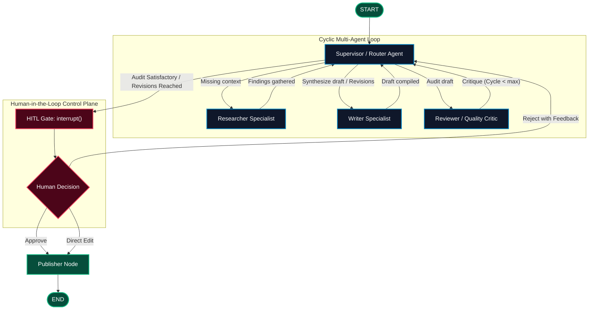

# Multi-Agent Human-in-the-Loop (HITL) Starter

[](https://github.com/your-org/multi-agent-hitl-starter/actions)
[](https://github.com/langchain-ai/langgraph)
[](https://fastapi.tiangolo.com)
[](https://react.dev)
[](https://opensource.org/licenses/MIT)

A lightweight, modular, portfolio- and production-ready starter application where specialized AI agents collaborate using **LangGraph** stateful cyclic orchestration, dynamic **Human-in-the-Loop (HITL)** gates, **runtime-configurable LLM providers**, and a real-time streaming **FastAPI + React** interface.

---

## 1. Problem Statement & Architecture

Autonomous multi-agent systems excel at decomposing complex deliverables (such as Incident Response Plans, Architecture Decision Records, or Technical Briefs) across specialized roles. However, unchecked autonomous loops risk hallucinations, style deviations, or executing irreversible actions.

This starter solves this challenge by pairing **cyclic agent orchestration** with **dynamic pause-and-resume gates**:
1. **Supervisor / Router Agent:** Formulates an actionable plan and routes tasks to specialists.
2. **Researcher Specialist:** Gathers technical constraints, benchmark targets, and architectural patterns.
3. **Writer / Synthesizer Specialist:** Compiles findings into structured Markdown.
4. **Reviewer / Critic Agent:** Audits quality and forces autonomous revision cycles if standards are not met.
5. **HITL Review Gate:** Leverages LangGraph's dynamic `interrupt()` primitive to freeze execution, persisting state to SQLite/Postgres.
6. **Human Decision (`Command(resume=...)`):** A human can **Approve** (publish), **Directly Edit** (override draft), or **Reject with Feedback** (loop back to the Writer).



---

## 2. Key Features

- **Dynamic `interrupt()` Primitive:** Uses LangGraph's native interrupt mechanism rather than brittle static breakpoints, enabling payload delivery and clean `Command(resume=...)` handling.
- **Durable Checkpointing:** Zero-setup local SQLite checkpointer (or Postgres in production) keyed by `thread_id`. Browser refresh or network reconnect mid-interrupt restores state instantly.
- **Pluggable LLM Layer:** Factory pattern with support for **Mock (Zero API Keys)**, OpenAI, Anthropic Claude, Google Gemini, AWS Bedrock, and Ollama (local). Switch providers in `.env` or live in the UI dropdown.
- **Role-Based Model Assignment:** Assign a reasoning model (e.g. `gpt-4o` or `claude-3-5-sonnet`) to the Supervisor/Reviewer and a fast model (`gpt-4o-mini`, `gemini-1.5-flash`) to the Researcher.
- **Real-Time SSE Streaming:** FastAPI streams agent node transitions, live progress logs, and token events over Server-Sent Events.
- **Modern Minimalist React UI:** Clean Tailwind CSS control plane with interactive node timeline, instant prompt presets, inline markdown editing, and human feedback controls.

---

## 3. Quickstart: 3-Step Setup

### Prerequisites
- Python 3.10+
- Node.js 18+ and npm
- *(Optional)* Docker and Docker Compose

### Option A: Local Development (Quickest)

#### Step 1: Clone & Configure Environment
```bash
git clone https://github.com/your-org/multi-agent-hitl-starter.git
cd multi-agent-hitl-starter

# Copy example environment configuration
cp .env.example .env
```
*(The default `LLM_PROVIDER=mock` requires zero API keys and works instantly out-of-the-box!)*

#### Step 2: Start the FastAPI Backend
```bash
cd backend
python -m venv .venv
source .venv/bin/activate  # On Windows: .venv\Scripts\activate
pip install -r requirements.txt

uvicorn app.main:app --reload --port 8000
```
Backend API will be running at `http://localhost:8000`. Interactive Swagger docs: `http://localhost:8000/docs`.

#### Step 3: Start the React Frontend
In a new terminal:
```bash
cd frontend
npm install
npm run dev
```
Open `http://localhost:3000` in your browser.

---

### Option B: One-Command Docker Compose
Launch the entire stack with persistence with a single command:
```bash
docker-compose up --build
```
- Frontend: `http://localhost:3000`
- Backend API: `http://localhost:8000`

---

## 4. Human-in-the-Loop (HITL) Walkthrough

```text
[1. Configure & Launch] ──> [2. Multi-Agent Pipeline] ──> [3. Dynamic HITL Gate] ──> [4. Human Action]
  - Pick Deliverable Type     - Supervisor creates plan      - Backend emits "interrupt"     - Approve
  - Select LLM Provider       - Researcher gathers facts     - UI surfaces Review Modal      - Direct Edit
  - Input Prompt              - Writer compiles draft        - State persisted to SQLite     - Reject + Critique
                              - Reviewer audits quality
```

1. **Launch a Workflow:** Choose a preset (e.g. *Database Outage Plan*) and click **Launch Workflow**.
2. **Observe Node Transitions:** Watch the **Agent Pipeline** stepper highlight `Supervisor` &rarr; `Researcher` &rarr; `Writer` &rarr; `Reviewer`.
3. **Execution Pauses at Human Gate:** The backend executes `interrupt()`, halting the graph. The **Human-in-the-Loop Review Modal** surfaces automatically.
4. **Choose a Human Action:**
   - **Approve As-Is:** Finalizes and publishes the verified draft.
   - **Directly Edit Text:** Modify paragraphs or add custom runbook steps directly in the markdown editor, then click **Save Edits & Publish**.
   - **Request Revision with Critique:** Provide feedback (e.g., *"Reduce P99 latency target to < 50ms"*). The workflow loops back to the Writer to address your critique.
5. **State Durability:** Refresh the browser mid-interrupt — the app queries `GET /api/runs/{thread_id}/state` and seamlessly restores the pending review panel!

---

## 5. Repository Structure

```text
multi-agent-hitl-starter/
├── .github/
│   └── workflows/
│       └── ci.yml                 # Automated pytest suite & frontend typecheck
├── backend/
│   ├── app/
│   │   ├── agents/                # Individual agent nodes (supervisor, researcher, writer, reviewer)
│   │   ├── graph/                 # Typed state schema, reducers, interrupt logic & builder
│   │   ├── llm/                   # Factory & provider adapters (Mock, OpenAI, Anthropic, Gemini, Bedrock, Ollama)
│   │   ├── api/                   # FastAPI routes, SSE streaming handler, Pydantic schemas
│   │   └── core/                  # Settings, structured logging & checkpointer setup
│   ├── tests/                     # Unit and integration test suite (12 passing tests)
│   ├── pyproject.toml             # Python package dependencies & tool config
│   ├── requirements.txt
│   └── Dockerfile
├── frontend/
│   ├── src/
│   │   ├── components/            # Header, ConfigurationBar, AgentTimeline, HumanApprovalPanel, OutputViewer
│   │   ├── hooks/                 # useAgentStream hook with SSE & thread_id persistence
│   │   ├── services/              # Typed REST client
│   │   └── App.tsx
│   ├── package.json
│   ├── vite.config.ts
│   └── Dockerfile
├── docs/
│   ├── architecture.md            # Mermaid sequence diagrams, state machines, ADRs
│   └── extending-agents.md        # Guide to creating custom agent nodes & adding LLM providers
├── .env.example                   # Fully documented configuration template
├── docker-compose.yml             # Single-command containerized deployment
└── README.md
```

---

## 6. API Reference

| Method | Endpoint | Description |
| :--- | :--- | :--- |
| `GET` | `/api/health` | Service health check |
| `GET` | `/api/providers` | Available LLM providers, model catalogs, and credential status |
| `POST` | `/api/runs` | Initialize a new multi-agent run; returns `thread_id` |
| `GET` | `/api/runs/{thread_id}/stream` | Server-Sent Events (SSE) stream for node events & interrupts |
| `POST` | `/api/runs/{thread_id}/resume` | Submit human decision (`approve`, `edit`, `reject`) |
| `GET` | `/api/runs/{thread_id}/state` | Checkpoint inspection (values, interrupt payload, next nodes) |

---

## 7. Running Tests

Run the complete backend test suite:
```bash
cd backend
pytest tests -v
```

All 12 unit and integration tests cover:
- Individual agent node behavior (`supervisor`, `researcher`, `writer`, `reviewer`)
- Graph cyclic execution and dynamic interrupt pausing
- HITL `approve`, `edit`, and `reject` feedback loops
- FastAPI endpoints, validation schemas, and error boundaries

---

## 8. License

Distributed under the MIT License. See [LICENSE](LICENSE) for details.
