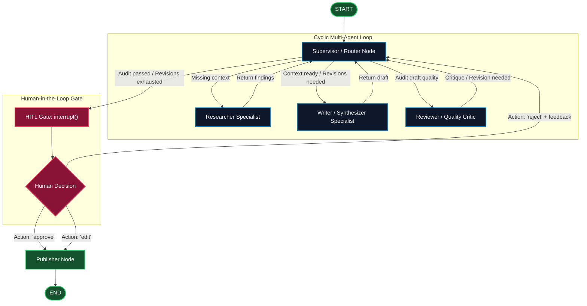
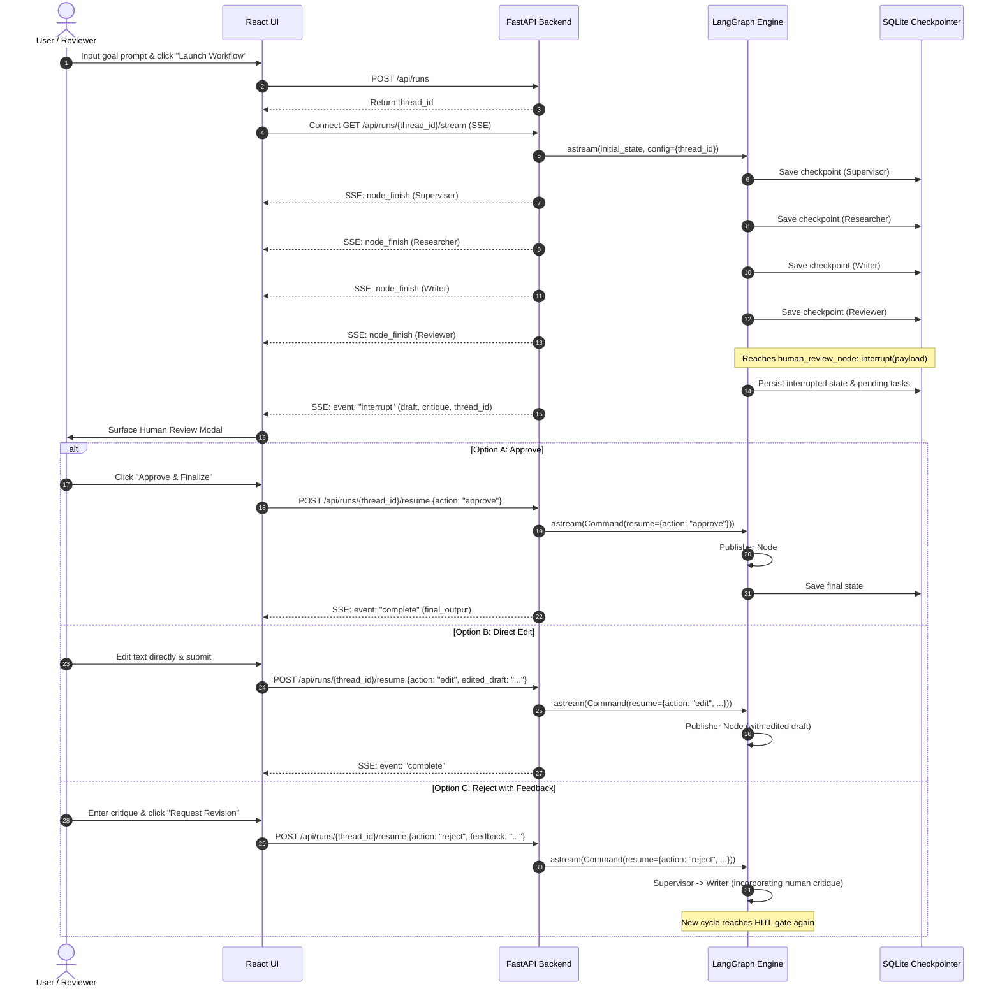

# Architecture & Design Decision Records (ADRs)

This document details the architectural blueprint, state management patterns, and Architecture Decision Records (ADRs) underpinning the **Multi-Agent HITL Starter** system.

---

## 1. System Overview & State Machine Flow

The orchestration layer uses **LangGraph** to implement a cyclic supervisor-worker topology with dynamic pause and resume gates:

---

## 2. Sequence Diagram: HITL Execution & Stream Flow

---

## 3. Architecture Decision Records (ADRs)

### ADR-001: Dynamic `interrupt()` vs Static Breakpoints

* **Context:** In multi-agent workflows, execution must pause before publishing or taking external actions. Early LangGraph versions relied on static breakpoints configured at compile time (`compile(interrupt_before=["node"])`).
* **Decision:** We adopt LangGraph's dynamic `interrupt()` primitive executed inside `human_review_node`.
* **Rationale:**
  1. **Dynamic Payload Handshake:** `interrupt(payload)` delivers rich context (the current draft, reviewer critique, revision counter) directly into the checkpoint's pending task. The frontend can retrieve this structured payload via SSE or `GET /api/runs/{thread_id}/state`.
  2. **Clean Value Resumption:** Resuming via `Command(resume=value)` cleanly returns the human's decision (`action`, `edited_draft`, `feedback`) as the return value of `interrupt()` within the node itself.
  3. **Conditional Triggers:** The node can decide whether to interrupt based on runtime conditions (e.g., skip review in fully automated testing mode or interrupt only when specific risk flags are raised).

### ADR-002: State Reducers & Message Overwrite Prevention

* **Context:** Concurrent worker updates in a cyclic graph can inadvertently overwrite previous messages or state keys if state is simply reassigned.
* **Decision:** We implement typed reducers in `AgentState`:
  - `messages: Annotated[List[BaseMessage], add_messages]`: Automatically appends messages and reconciles IDs using LangGraph's standard reducer.
  - `events: Annotated[List[Dict[str, Any]], operator.add]`: Appends audit logs without clobbering preceding agent transitions.
  - Granular scalar keys (`draft`, `critique`, `revision_count`): Each specialist node returns a partial dictionary containing only the keys it mutates.
* **Consequences:** Eliminates message loss across cyclic iterations; enables auditability of the full multi-agent trajectory.

### ADR-003: Idempotency & Checkpointer Durability

* **Context:** In web applications, users frequently refresh the browser, disconnect during SSE streaming, or double-click resume buttons.
* **Decision:**
  1. Every execution run is keyed by a unique `thread_id`.
  2. State is checkpointed atomically before each node and directly upon entering `interrupt()`.
  3. When a browser reconnects or refreshes, `GET /api/runs/{thread_id}/state` checks `state.tasks[0].interrupts`. If interrupted, it immediately restores the HITL approval modal with zero loss of progress.
  4. If `POST /api/runs/{thread_id}/resume` is invoked, the resume command is committed against the current checkpoint. Duplicate submissions on an already-resumed thread fail gracefully without corrupting graph state.
